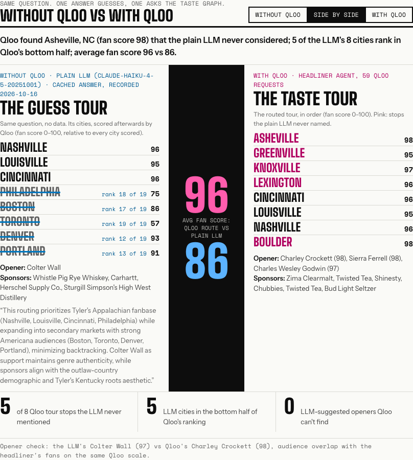
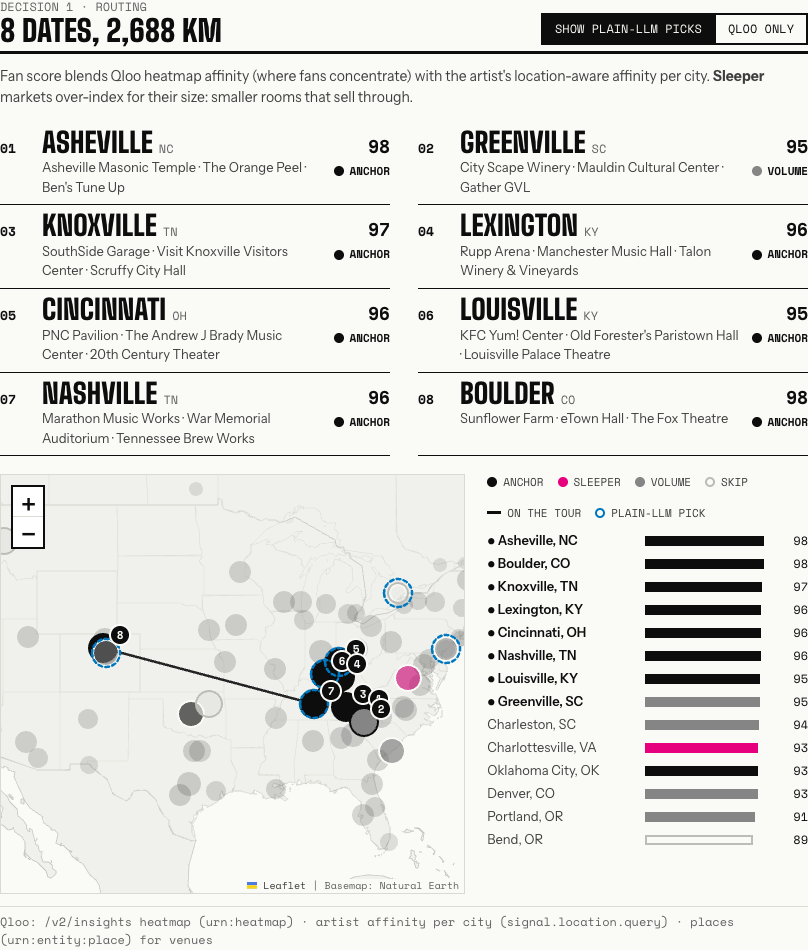
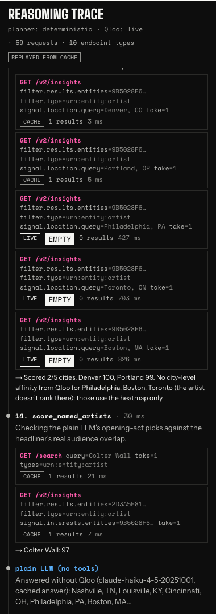

# Headliner: tour decisions on Qloo taste data, not guesswork

**Headliner is an agent for live-music promoters and tour planners. Give it an artist and it routes the tour, picks the opening act and lines up sponsors, using Qloo's taste graph. Every Qloo call it makes is shown in a live reasoning trace, and its plan sits next to a plain LLM's answer to the same question.** Ask a plain LLM (Claude Haiku 4.5) to route an 8-date Tyler Childers tour and it sends him to Philadelphia, Boston and Toronto. Qloo scores those cities 75, 86 and 57 for his fans; Headliner's route averages **96 vs 86** and starts in Asheville, NC, a market the LLM never named. Headliner asks **Qloo** where the fans actually concentrate. It finds the *sleeper* markets that over-index for their size, the opener whose fans overlap in each city, and the brands this audience buys. Then it scores the LLM's cities with the same Qloo calls, so the difference is measured rather than claimed.


<sub>Live Qloo data (hackathon API, 16 Oct 2026). The plain-LLM column is a cached answer from Claude Haiku 4.5 to the same prompt; see "What's live and what's cached" below.</sub>

**Live demo: https://headliner-qloo-eta.vercel.app** · no login · one click: **Try a sample → Tyler Childers**

### What's live and what's cached

- **Qloo: live.** Every request in the trace goes to `hackathon.api.qloo.com`. Responses and finished runs are cached server-side, and 16 artists (the samples plus a dozen judges might type) are pre-run before each deploy so they replay instantly. Any other artist runs live, in about 15–25 s.
- **Planner: deterministic** on the demo host (the same 12 Qloo tools in a fixed order). With `LLM_*` configured, a tool-calling LLM plans instead ([example run](docs/LLM_PLANNER_RUN.md)).
- **"Without Qloo" answers: cached.** The demo host holds no LLM key, so the plain-LLM answers were recorded ahead of time from Claude Haiku 4.5 with the app's exact prompt (`fixtures/baseline/`, labelled "cached answer" in the UI) for those 16 artists. For other artists the comparison panel says so instead of inventing one.

---

## Who it's for

Promoters, talent buyers and tour managers at agencies and venue groups. A 20-city headline tour is a multi-million-dollar bet made on three calls:

| Decision | How it's made today | What Headliner adds |
|---|---|---|
| **1. Routing**: which cities and rooms | last tour's ticket counts, streaming dashboards, gut feel | Qloo **heatmap** of where the artist's fans concentrate across the region, plus Qloo's **location-aware affinity** for each candidate city. Markets are tiered *anchor / sleeper / volume / skip* and ordered into a drivable route, with Qloo-matched **venues** for every stop |
| **2. Support act**: who opens | the agency's roster, favours, Spotify "fans also like" | Qloo **insights** for artists the headliner's fans love, capped below the headliner's popularity, then **re-ranked against the fans in each market** and explained with Qloo's **audience compare** (shared taste tags) |
| **3. Sponsors & merch**: who pays | generic category pitches | Qloo **cross-domain** brand affinity (food & drink, fashion, beer/wine/spirits), tour-wide and **per market**, plus local hospitality partners. An LLM alone cannot know this |
| **4. The brief** | a deck someone builds over a week | a one-page printable brief and a CSV, generated in seconds |

## How Qloo is used

The agent plans its own sequence of Qloo calls (a tool-calling LLM, or a deterministic planner when no LLM is configured) against the **Qloo hackathon API** (`https://hackathon.api.qloo.com`, `X-Api-Key` header, GET only; no legacy `/recommendations` or `/recs`):

| Endpoint | Used for |
|---|---|
| `GET /search` (`types=urn:entity:artist`) | resolve the headliner, and the plain LLM's suggested openers, to Qloo entity IDs |
| `GET /v2/tags` (`filter.query`, `feature.semantic_search`) | find valid tag IDs for *music venue*, *bar*, and the sponsor categories |
| `GET /v2/insights` `filter.type=urn:heatmap` + `filter.location` (region polygon) + `output.heatmap.boundary=urn:geohash` (cells folded into cities) | where fans concentrate across the region (affinity vs popularity → over-index) |
| `GET /v2/insights` `filter.type=urn:entity:artist` + `filter.results.entities` + `signal.location.query` | the artist's affinity in each candidate city; support-act overlap per market |
| `GET /v2/insights` `filter.type=urn:entity:artist` + `signal.interests.entities` + `filter.popularity.max` + `feature.explainability` | support-act candidates |
| `GET /v2/insights` `filter.type=urn:entity:place` + `filter.location.query` + `filter.tags` | venues and hospitality partners whose patrons share the taste |
| `GET /v2/insights` `filter.type=urn:entity:brand` + `filter.tags` (+ `signal.location.query`) | sponsor and merch leads, tour-wide and per market |
| `GET /v2/insights` `filter.type=urn:tag` | the audience's taste profile |
| `GET /v2/insights` `filter.type=urn:demographics` | age and gender skew for sponsor fit |
| `GET /v2/analysis/compare` | why two fan bases overlap (shared taste tags) |
| `GET /v2/trending` | audience momentum, for sizing rooms |

A typical run makes about 60 Qloo requests across 5 endpoints and 6 insight types. Nothing about any artist is hard-coded: every city, venue, act and brand in a plan comes from a Qloo response.

## The with/without-Qloo toggle

The same question goes to the configured LLM **without tools**. Headliner then **fact-checks** that answer with Qloo: it scores the LLM's cities with the same per-city affinity call and looks up the LLM's suggested openers. The comparison panel shows:
- the average fan score of the LLM's cities vs Headliner's route,
- tour stops the LLM never mentioned (usually the sleeper markets),
- LLM-suggested openers that Qloo can't find, or whose fans barely overlap.

This answers the hackathon brief's line, *"If your submission would work the same without Qloo, you're building the wrong thing,"* with a number.

## Screenshots

| Routing map and market tiers | Reasoning trace (every Qloo call) |
|---|---|
|  |  |

Full page: [desktop](docs/img/full-desktop.png) · [mobile](docs/img/mobile.png) · [printable brief](docs/img/brief.png). Devpost gallery and thumbnail: [`docs/gallery/`](docs/gallery). All screenshots are from the live deployment (live Qloo data).

## Architecture

- **Next.js 15 + TypeScript**, one deployable app. `POST /api/run` streams agent events as NDJSON, and the UI renders the reasoning trace as they arrive.
- **Agent** (`src/lib/agent/`): 12 Qloo-backed tools. With `LLM_*` set, an OpenAI-compatible tool-calling loop chooses the tools and writes the brief. Every tool call carries a one-line `reason` shown in the trace. Without an LLM, a deterministic planner runs the same tools. A coverage guard makes sure every decision in the brief is grounded in Qloo before the run finishes. [Example of a real LLM-planned run](docs/LLM_PLANNER_RUN.md).
- **Qloo client** (`src/lib/qloo/`): typed endpoints with zod schemas, retries on 429/5xx, flags empty results (Qloo silently ignores invalid parameters), refuses any host other than `hackathon.api.qloo.com`, and caches responses server-side (memory + disk). Finished runs are cached too and replayed with their trace, so judging never waits.
- **Deploy**: Vercel, from a local prebuilt build so the pre-run demo artists (`seed/runs/`, gitignored: Qloo data stays out of the repo) ship with the functions. See [docs/DEPLOY.md](docs/DEPLOY.md).
- **Fixture mode**: with no `QLOO_API_KEY`, Qloo answers come from `fixtures/qloo/`, generated by running the real agent against a schema-faithful stand-in. They are **labelled as fixtures in the UI and the code**, and the names and scores in them are placeholders. `scripts/qloo-smoke.sh` re-records real fixtures into `fixtures/live/`, which is gitignored because Qloo data must not be published in a public repo.
- **Map**: Leaflet over a self-hosted Natural Earth basemap, so no tile service can rate-limit or expire during judging.

## Run it

```bash
npm ci
cp .env.example .env      # leave QLOO_API_KEY empty for fixture mode
npm run dev               # http://localhost:3000, then click a sample artist
npm test                  # 52 tests
```

With a key: `QLOO_API_KEY=... scripts/qloo-smoke.sh` checks every endpoint and parameter the app uses, then re-records fixtures. Deploy: see [docs/DEPLOY.md](docs/DEPLOY.md).

Data note: Qloo scores describe aggregate audience affinity, not individuals. Headliner sends Qloo no personal data.

## Licence

[MIT](LICENSE)
